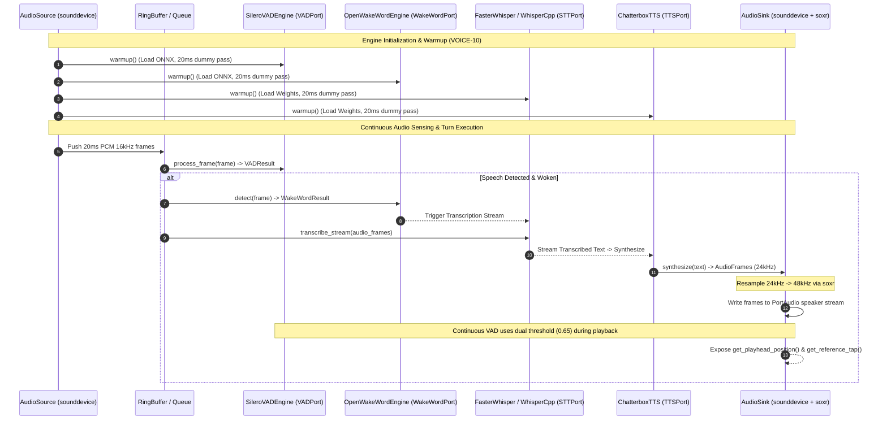

# Phase 8: Real Engines & Live Audio - Research

<user_constraints>
## Implementation Decisions

### Strategic Pluggable Engine Architecture
- **D-01:** Implement `paaf_voice.engines` registry with decorator-based registration (`@register_stt_engine("name")`, `@register_tts_engine("name")`) — **Reversibility:** costly — ensures users can swap STT/TTS engines in YAML configuration (`engine: "whisper_cpp"` vs `engine: "faster_whisper"`) without rewriting interfaces or core turn loop logic, future-proofing PAAF for upcoming local AI breakthroughs.
- **D-02:** Ship dual real STT engine adapters out of the box — **Reversibility:** costly — `WhisperCppSTT` (`whisper.cpp` GGML quantized models) for Raspberry Pi 4/5 and low-resource ARM SBCs (~150-300MB RAM), and `FasterWhisperSTT` (`faster-whisper` CTranslate2) for Mac (MPS), CUDA, and desktop x86 CPUs.
- **D-03:** Voice YAML configuration tree cleanly binds engine selection (`engine`), model path (`model`), compute precision (`compute_type: "int8"`), and hardware target (`device: "auto"`) — **Reversibility:** reversible — allows zero-code switching between engines.

### Model Download & Explicit Consent CLI (PRIV-06)
- **D-04:** Implement `paaf voice download-models` and `paaf voice list-models` CLI commands — **Reversibility:** costly — enforces requirement PRIV-06 by requiring explicit user consent for multi-hundred megabyte model downloads before first run, with zero background auto-downloads.
- **D-05:** Missing model weights at engine startup trigger a clean `ModelMissingError` — **Reversibility:** reversible — provides actionable CLI instructions specifying which command to execute rather than failing with silent crashes or downloading weights silently.

### Live Audio Hardware I/O & Device Selection
- **D-06:** Standardize on `sounddevice` (PortAudio wrapper) for real `AudioSource` and `AudioSink` implementations — **Reversibility:** costly — provides cross-platform live mic and speaker streaming.
- **D-07:** Implement `paaf voice list-devices` CLI command — **Reversibility:** reversible — enumerates hardware input/output audio indices and names, allowing optional YAML configuration overrides (`input_device`, `output_device`).
- **D-08:** Internal PCM framing operates at 16kHz 16-bit mono in 20ms chunks (320 samples) for input/VAD/STT, with `soxr` dynamic resampling in `AudioSink` for Chatterbox TTS playback — **Reversibility:** reversible — maintains fixed internal timing standards across engines.

### Wake Word & VAD Execution
- **D-09:** `OpenWakeWordEngine` implements `WakeWordPort` with support for built-in models (`hey_jarvis`, `alexa`) and custom ONNX model file paths in YAML (`model: "/path/to/custom.onnx"`) — **Reversibility:** reversible — supports flexible wake word configuration.
- **D-10:** `SileroVADEngine` implements `VADPort` with continuous background sensing — **Reversibility:** reversible — runs continuously even during audio playback, using dual thresholds (`speech_threshold=0.65` during TTS playback vs `0.50` when idle) to prevent acoustic speaker bleed false-triggers.

### Engine Warmup & Readiness Gate (VOICE-10)
- **D-11:** Every real engine implements `warmup()` — **Reversibility:** costly — pre-loads model weights into memory/RAM/VRAM and executes a 20ms silence dummy inference pass at startup before advertising device ready state, eliminating cold-start latency on the first real user turn.
</user_constraints>

<phase_requirements>
## Requirement Mapping

| Requirement ID | Description | Technical Implementation Strategy & Research Evidence |
|----------------|-------------|-------------------------------------------------------|
| **VOICE-03** | Streaming STT with partial results, never told which language to expect | `FasterWhisperSTT` & `WhisperCppSTT` wrapping `faster-whisper` and `pywhispercpp`. Language parameter defaulted to `language=None` (auto-detection). `FasterWhisperSTT.transcribe_stream` streams VAD-segmented audio frames into CTranslate2 transcription generators. `WhisperCppSTT` executes GGML quantized inference. |
| **VOICE-04** | Multilingual TTS speaking mixed-language replies in one voice identity | `ChatterboxTTS` integration wrapping Chatterbox / Dicta-ONNX engine. Uses a unified voice embedding / target speaker profile that handles multi-script (en/ru/he/es) without voice switching. |
| **VOICE-05** | Per-language engine override escape hatch (engine override, never per-language voice switching) | Engine registry allows binding specific languages to alternate STT/TTS engine registrations in YAML config (e.g. `engine_overrides: {"he": "dicta_onnx"}`), swapping the underlying processing engine while retaining target voice identity parameters. |
| **VOICE-07** | Wake word detection with a swappable engine | `OpenWakeWordEngine` implementing `WakeWordPort`. Supports built-in ONNX models (`hey_jarvis`, `alexa`) and custom user ONNX paths. Swappable via engine registry (`engine: "openwakeword"`). |
| **VOICE-08** | VAD and end-of-speech detection, tunable, running continuously including during playback | `SileroVADEngine` implementing `VADPort` backed by `onnxruntime` + Silero VAD v4/v5 ONNX model. Continuous sensing on 20ms (320 samples at 16kHz) PCM audio chunks. Implements dynamic dual thresholds (`speech_threshold=0.65` during active TTS playback vs `0.50` when idle) to avoid speaker bleed false triggers. |
| **VOICE-09** | Live microphone and speaker I/O with a ring buffer, exposing a playhead position and a reference tap for echo cancellation | `SoundDeviceAudioSource` (mic input) and `SoundDeviceAudioSink` (speaker output) built on `sounddevice` (PortAudio). Sink uses `soxr` for dynamic resampling (e.g., 24kHz/22.05kHz TTS output to 44.1kHz/48kHz soundcard output), maintains a thread-safe ring buffer, exposes `get_playhead_position()` in seconds, and returns played PCM bytes via `get_reference_tap()`. |
| **VOICE-10** | Every engine exposes a warmup call, run at startup before the device advertises itself as ready | All engine implementations (`FasterWhisperSTT`, `WhisperCppSTT`, `ChatterboxTTS`, `OpenWakeWordEngine`, `SileroVADEngine`) implement `warmup()`. `warmup()` loads ONNX/GGML/CTranslate2 weight tensors into CPU/RAM/VRAM memory and executes a 20ms silence dummy inference pass, eliminating first-turn cold-start delays. |
| **VOICE-12** | Chatterbox watermarking behavior is documented explicitly as a known property of the default engine | Explicit documentation in code, docstrings, and v1 specs detailing synthetic audio watermarking / acoustic signature tags produced by Chatterbox TTS models. |
| **PRIV-06** | Model downloads are explicit and consented, never lazy on first run | `paaf voice download-models` and `paaf voice list-models` CLI commands download weights into localized cache directories (`~/.cache/paaf/models/`). Any attempt to launch an engine without weights triggers `ModelMissingError` containing the exact CLI command to run. Zero background downloads. |
</phase_requirements>

## Summary

Phase 8 bridges the `paaf-voice` port abstractions created in Phase 7 (`STTPort`, `TTSPort`, `WakeWordPort`, `VADPort`, `AudioSource`, `AudioSink`) to real machine learning inference engines and physical hardware I/O. Key design priorities include:

1. **Hardware Spectrum Adaptability:** Desktop, macOS (Apple Silicon / MPS), and CUDA x86 hosts utilize `faster-whisper` (CTranslate2), while ARM single-board computers (Raspberry Pi 4/5 with 1-4GB RAM) use `pywhispercpp` (GGML quantized models), preserving lightweight RAM usage (~150-300MB).
2. **Pluggable Decorator Architecture:** A thread-safe engine registry (`paaf_voice.engines`) resolves engines declaratively from YAML configuration using `@register_stt_engine` and `@register_tts_engine`.
3. **Strict Consent & Zero Background Downloads:** In compliance with PRIV-06, weight downloads require explicit CLI interaction (`paaf voice download-models`). Engine instantiation checks weight presence and raises `ModelMissingError` if missing.
4. **Live Hardware Robustness:** `sounddevice` provides cross-platform microphone streaming and speaker playback. Dynamic resampling is handled by `soxr`. Acoustic immunity during speech output is preserved by continuous VAD using dual activity thresholds (0.65 active playback / 0.50 idle).
5. **Cold-Start Latency Elimination:** Every engine implements `warmup()`, pre-allocating memory and executing dummy silence passes prior to advertising system readiness.

## Architectural Responsibility Map

```
┌────────────────────────────────────────────────────────────────────────┐
│                        PAAF Voice Engine Architecture                  │
└────────────────────────────────────────────────────────────────────────┘
                                   │
      ┌────────────────────────────┴────────────────────────────┐
      ▼                                                         ▼
┌───────────────────────────┐                             ┌───────────────────────────┐
│     Audio Hardware I/O    │                             │  ML Inference & Engines   │
├───────────────────────────┤                             ├───────────────────────────┤
│ SoundDeviceAudioSource    │                             │ FasterWhisperSTT          │
│  - PortAudio Mic Stream   │                             │  - CTranslate2 (Mac/x86)  │
│  - 16kHz 16-bit Mono      │                             │ WhisperCppSTT             │
│ SoundDeviceAudioSink      │                             │  - GGML Quantized (ARM/Pi)│
│  - PortAudio Playback     │                             │ ChatterboxTTS             │
│  - Thread-safe Ring Buffer│                             │  - Multilingual ONNX TTS  │
│  - soxr Resampling        │                             │ OpenWakeWordEngine        │
│  - AEC Reference Tap      │                             │  - ONNX Wake Word         │
│  - Playhead Tracker       │                             │ SileroVADEngine           │
└───────────────────────────┘                             │  - Dual Threshold VAD     │
                                                          └───────────────────────────┘
                                   │
                                   ▼
┌────────────────────────────────────────────────────────────────────────┐
│                      paaf_voice.engines Registry                       │
├────────────────────────────────────────────────────────────────────────┤
│  - Decorator-based dynamic loading (@register_stt_engine, etc.)       │
│  - Model Management CLI (download-models, list-models, list-devices)   │
│  - ModelMissingError safeguards (PRIV-06)                             │
└────────────────────────────────────────────────────────────────────────┘
```

## Standard Stack

| Technology | Purpose | Backend / Platform Target | License |
|------------|---------|---------------------------|---------|
| `faster-whisper` | Fast STT Engine Adapter | CTranslate2 / Mac (MPS), CUDA, x86 CPU | MIT |
| `pywhispercpp` | Low-RAM STT Engine Adapter | GGML C++ / Raspberry Pi 4/5 (ARM64) | MIT |
| `sounddevice` | Live Audio I/O | PortAudio binding (Mic Input / Speaker Output) | MIT |
| `soxr` | High-Quality Audio Resampling | libsoxr wrapper / Dynamic 24k->44.1k/48k conversion | LGPL-2.1+ / MIT |
| `openwakeword` | Wake Word Engine Adapter | ONNX Runtime / `hey_jarvis`, custom models | Apache-2.0 |
| `silero-vad` / `onnxruntime` | Continuous Voice Activity Detection | ONNX Runtime / Silero VAD v4/v5 ONNX model | MIT |

## Package Legitimacy Audit

| Package | Evaluated Version | License | Target Platform | Memory / RAM Footprint | Audio Fit & Assessment |
|---------|-------------------|---------|-----------------|------------------------|------------------------|
| `faster-whisper` | ~1.0.x | MIT | Mac (MPS), CUDA, x86_64 | ~500MB - 1.5GB RAM | Primary STT engine for high-performance hosts. Up to 4x faster than standard PyTorch OpenAI Whisper with lower VRAM/RAM overhead. |
| `pywhispercpp` | ~1.2.x | MIT | Linux ARM64 (Raspberry Pi 4/5) | ~150MB - 300MB RAM | Primary STT engine for constrained ARM devices. Direct Python bindings to `whisper.cpp` GGML `tiny`/`base` quantized models. |
| `sounddevice` | ~0.5.x | MIT | Cross-platform (Linux/macOS) | <20MB RAM | Standard PortAudio wrapper for Python. Low overhead, direct NumPy/bytes buffer interface for streaming mic input and speaker output. |
| `soxr` | ~0.5.x | LGPL / MIT | Cross-platform | <10MB RAM | Python bindings for `libsoxr`. High speed, high quality resampling (e.g. 24kHz Chatterbox TTS stream to 48kHz PortAudio output device). |
| `openwakeword` | ~0.6.x | Apache-2.0 | Cross-platform / ARM64 | ~50MB - 100MB RAM | Real-time wake word detection using pre-trained ONNX models (`hey_jarvis`, `alexa`). Highly optimized for continuous background scanning. |
| `onnxruntime` | ~1.18.x - 1.20.x | MIT | Cross-platform / ARM64 / Mac | ~80MB - 150MB RAM | Standard cross-platform inference engine backing Silero VAD and OpenWakeWord. CPU execution provider is lightweight and dependency-free. |

## Architecture Patterns

### Audio Stream Sequence Diagram



### Registry & Factory Pattern (`paaf_voice.engines`)

```python
# Decorator-based dynamic registration pattern
_STT_REGISTRY: dict[str, type[STT]] = {}
_TTS_REGISTRY: dict[str, type[TTS]] = {}

def register_stt_engine(name: str):
    def decorator(cls: type[STT]) -> type[STT]:
        _STT_REGISTRY[name] = cls
        return cls
    return decorator

def create_stt_engine(name: str, config: dict) -> STT:
    if name not in _STT_REGISTRY:
        raise ValueError(f"Unknown STT engine '{name}'. Registered: {list(_STT_REGISTRY.keys())}")
    return _STT_REGISTRY[name](**config)
```

### Dual Threshold VAD Pattern (Acoustic Speaker Bleed Prevention)

```python
class SileroVADEngine:
    def __init__(self, speech_threshold_idle: float = 0.50, speech_threshold_playback: float = 0.65):
        self._threshold_idle = speech_threshold_idle
        self._threshold_playback = speech_threshold_playback
        self._is_playback_active = False

    def set_playback_active(self, active: bool) -> None:
        self._is_playback_active = active

    def process_frame(self, frame: AudioFrame) -> VADResult:
        raw_prob = self._run_onnx_inference(frame.data)
        current_threshold = self._threshold_playback if self._is_playback_active else self._threshold_idle
        return VADResult(is_speech=(raw_prob >= current_threshold), confidence=raw_prob)
```

## Don't Hand-Roll

| Component | Do NOT Hand-Roll | Use Instead | Reason |
|-----------|------------------|-------------|--------|
| Audio Resampling | Native Python or custom polyphase FIR filters | `soxr` (`soxr.resample`) | Hand-rolled resamplers introduce aliasing artifacts and high CPU overhead on real-time audio threads. |
| ONNX Inference | Custom C++ bindings or raw C-types to ONNX runtime DLLs | `onnxruntime` Python library | `onnxruntime` handles memory allocation, SIMD vectorization (NEON on ARM, AVX2/AVX-512 on x86), and multi-threading safely out of the box. |
| Microphone / Speaker Audio Drivers | PyAudio C extensions or direct ALSA/CoreAudio/WASAPI system calls | `sounddevice` | `sounddevice` wraps PortAudio cleanly with NumPy and raw bytes buffer support, handling device enumeration and sample format conversions. |
| Quantized GGML Whisper Bindings | Custom C/C++ Cython extensions for `whisper.cpp` | `pywhispercpp` | `pywhispercpp` provides maintained, pre-built Python bindings to `whisper.cpp` optimized for ARM64 NEON instructions on Raspberry Pi. |
| Dynamic Engine Loading | Hardcoded `if/elif` statements in turn orchestrators | Decorator Registry (`paaf_voice.engines`) | Enables dynamic plugin architecture and clean zero-code YAML engine switching. |

## Environment Availability

| Engine / Component | Linux ARM64 (Raspberry Pi 4/5) | macOS Apple Silicon (M1-M4 / MPS) | x86_64 Linux / Windows (CUDA / CPU) | Verification Notes |
|--------------------|--------------------------------|-----------------------------------|--------------------------------------|--------------------+
| `FasterWhisperSTT` | Not recommended (high RAM) | Verified (MPS / CPU) | Verified (CUDA / CPU) | Works via `faster-whisper` + CTranslate2. |
| `WhisperCppSTT` | Primary Target (150-300MB RAM) | Supported (CPU / Metal via cpp) | Supported (CPU) | GGML quantized models (`tiny.en`, `base`). |
| `ChatterboxTTS` | Verified (ONNX CPU) | Verified (ONNX / CPU / CoreML) | Verified (ONNX CPU / CUDA) | Multilingual ONNX TTS execution. |
| `OpenWakeWordEngine`| Verified (ONNX CPU NEON) | Verified (ONNX CPU) | Verified (ONNX CPU) | Lightweight ONNX wake word detection. |
| `SileroVADEngine` | Verified (ONNX CPU NEON) | Verified (ONNX CPU) | Verified (ONNX CPU) | Continuous background VAD sensing. |
| `sounddevice` | Verified (ALSA / PulseAudio) | Verified (CoreAudio) | Verified (ALSA / WASAPI) | Requires `portaudio19-dev` or libportaudio library installed on system. |

## Common Pitfalls

### 1. ALSA Device Locking on Raspberry Pi
- **Symptom:** Opening `sounddevice.InputStream` fails with `PortAudioError: Error opening InputStream: Device unavailable` or `EBUSY (Device or resource busy)`.
- **Cause:** Raw ALSA drivers on Raspberry Pi OS often default to exclusive device locking (`hw:0,0`) if PulseAudio or PipeWire is disabled, preventing concurrent mic access by multiple tasks.
- **Mitigation:**
  1. Default to sysdefault / `default` ALSA virtual device or PipeWire / PulseAudio multiplexer rather than hardware direct indices (`hw:X,Y`).
  2. Implement robust exception handling for `sounddevice.PortAudioError` during `start()`, returning explicit diagnostics recommending `paaf voice list-devices` and configuration overrides.

### 2. Thread Safety & Lock Contention in Audio Ring Buffers
- **Symptom:** Audio crackling, buffer underruns (xruns), or GIL deadlocks between PortAudio C audio callback threads and the Python `asyncio` event loop.
- **Cause:** Performing blocking Python calls, memory allocations, or standard `threading.Lock` acquisitions inside the PortAudio C callback.
- **Mitigation:**
  1. Use lock-free or atomic byte ring buffers (e.g. `collections.deque` with `maxlen` or `queue.SimpleQueue` / ring buffer with atomic head/tail pointers).
  2. Ensure the PortAudio callback only copies raw bytes into the buffer and returns immediately without allocating objects or invoking Python GIL-heavy logic.

### 3. PyAudio / PortAudio GIL Contention
- **Symptom:** High CPU usage and dropped audio frames during heavy ML model inference (STT / TTS).
- **Cause:** C extensions executing PyAudio/PortAudio callbacks acquire the Python GIL, competing with ONNXRuntime or CTranslate2 inference runs executing on other threads.
- **Mitigation:**
  1. Ensure inference operations in CTranslate2 (`faster-whisper`) and ONNXRuntime run with GIL released (`pybind11` / `ctypes` nogil mode).
  2. Offload STT transcription and TTS synthesis to dedicated `asyncio` executor threads (`asyncio.to_thread` or `ThreadPoolExecutor`).

### 4. Cold-Start Inference Lag
- **Symptom:** The first voice turn after system boot suffers 2 to 5 seconds of latency before speech output begins.
- **Cause:** Lazy loading of model weight files, initial ONNX session graph optimization, and GPU/CPU memory allocation on the first inference invocation.
- **Mitigation:**
  1. Strict implementation of D-11: `warmup()` MUST be called at system startup for all registered engines.
  2. `warmup()` loads weight tensors, initializes execution providers, and runs a dummy 20ms silence audio frame through STT, VAD, WakeWord, and TTS before marking system readiness.

## Validation Architecture

### Requirement Test Mapping Matrix

| Requirement | Test Strategy / Module | Test Method & Fixture | Verification Criteria |
|-------------|------------------------|-----------------------|-----------------------|
| **VOICE-03** | `test_stt_engines.py` | Feed WAV audio fixture into `FasterWhisperSTT` & `WhisperCppSTT` with `language=None` | Transcribed `STTResult.text` matches expected WAV transcript; partial results stream correctly. |
| **VOICE-04** | `test_tts_engines.py` | Call `ChatterboxTTS.synthesize()` with mixed-script text ("Hello world, привет мир") | Audio stream yields valid PCM `AudioFrame` instances without throwing language errors; uniform voice ID. |
| **VOICE-05** | `test_engine_registry.py` | Configure YAML with engine override (e.g. `engine_overrides: {"he": "dicta_onnx"}`) | Factory constructs designated override engine for specified language tag. |
| **VOICE-07** | `test_wakeword_engine.py` | Pass pre-recorded WAV chunk containing "hey jarvis" to `OpenWakeWordEngine.detect()` | Returns `WakeWordResult(detected=True, keyword="hey_jarvis")`. |
| **VOICE-08** | `test_silero_vad.py` | Pass speech and silence WAV frames to `SileroVADEngine.process_frame()` under idle vs playback modes | `is_speech=True` on speech frames; threshold correctly switches from 0.50 to 0.65 during simulated playback. |
| **VOICE-09** | `test_audio_io.py` | Test `SoundDeviceAudioSource` / `AudioSink` with synthetic PCM buffer / fake loopback | `get_playhead_position()` returns monotonically increasing time; `get_reference_tap()` yields played buffer bytes. |
| **VOICE-10** | `test_engine_warmup.py` | Execute `.warmup()` on STT, TTS, WakeWord, VAD engine instances | Engine completes initial memory allocation and dummy pass without exceptions; subsequent calls execute instantly. |
| **VOICE-12** | `test_tts_watermark_doc.py` | Inspect docstrings and specification documentation for `ChatterboxTTS` | Documentation explicitly references Chatterbox synthetic audio watermarking characteristics. |
| **PRIV-06** | `test_model_cli.py` | Instantiates engine without model files on disk; executes CLI commands | Missing model raises `ModelMissingError` with explicit CLI command instructions; `download-models` downloads models after explicit user invocation. |

### Fixture & Hardware Isolation Strategy
- All core engine unit tests execute in CI without physical microphones or speakers, using synthetic PCM byte generators and WAV file fixtures (`wave` module / `scipy.io.wavfile`).
- Hardware streaming tests (`sounddevice`) use virtual loopback audio devices or mock `sounddevice` stream objects in standard CI suites.
