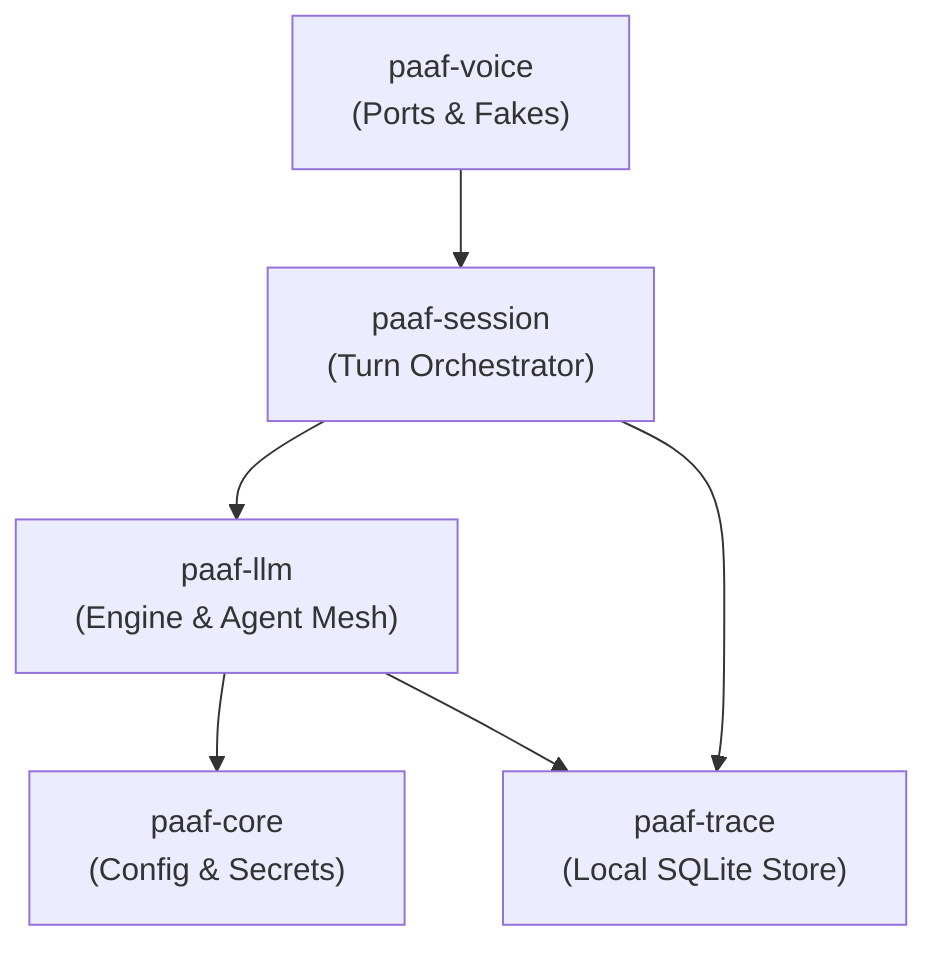

<!-- SPDX-License-Identifier: Apache-2.0 -->

# PAAF Architecture

This document is the map for an outsider: what the pieces are, where things
live, and the rules that keep the pieces swappable. Read
[`CONTRIBUTING.md`](CONTRIBUTING.md) to build and test, and
[`DECISIONS.md`](DECISIONS.md) for the commitments the architecture exists
to protect.

## The shape in one paragraph

PAAF is delivered as **a framework** (a Python package set the user owns and
can verify) and, later, **two apps** (an embedded assistant process and an
Electron desktop control panel). The framework is a
[uv](https://docs.astral.sh/uv/) **workspace monorepo** of five
independently-versioned packages under `packages/`. Everything the user
configures — which model, which skills, which tools, which persona, what the
assistant does while it thinks — is a user-facing concept, not code, backed
by a validated config tree and an encrypted secret store, with every run
recorded locally and **nothing ever leaving the device**.

## The five framework packages

| Package | Path | Phase-2 state | Responsibility |
|---------|------|---------------|----------------|
| **paaf-core** | `packages/paaf-core` | **real** | Config (one validated YAML tree, atomic writes, revision/conflict, reload tiers), the encrypted `SecretStore`, and the network-endpoint declaration interface that makes offline enforcement architectural. |
| **paaf-trace** | `packages/paaf-trace` | **real** | Local append-mostly SQLite trace store (WAL, single writer off the audio hot path) recording prompts, model, tool calls with args/results, timings, token counts, and `time_to_first_audio`. Nothing in it ever leaves the device. |
| **paaf-llm** | `packages/paaf-llm` | **stub** (D-18) | Module 1 — LLM management (model profiles, tools, persona, behaviors). The real port + engine land in **Phase 3**; the agent framework (LangChain/LangGraph) lives behind the port in `paaf_llm._engine` and never leaks. Ships to **PyPI in Phase 5** (OSS-01). |
| **paaf-voice** | `packages/paaf-voice` | **stub** | Module 2 — streaming STT/TTS, wake word, VAD, audio I/O, each behind a swappable interface. Real engines land in Phase 6+. |
| **paaf-session** | `packages/paaf-session` | **stub** | The turn orchestrator (wake → capture → transcribe → think → speak, barge-in). Deliberately **narrow**: it owns only what requires knowing that time is passing and audio is playing. Lands in Phase 8. |

In Phase 2, `paaf-core` and `paaf-trace` carry real implementation; the other
three are **importable stubs** (each is a real installable package exposing
`__version__`, with the real surface deferred, per D-05/D-06/D-18). This lets
the workspace resolve, the import boundaries be enforced, and CI be green
from day one without waiting on the later modules.

### The two apps are deferred (D-07)

The **embedded app** (a single Linux-service process wiring the session to
real audio devices, exposing a LAN-only REST + WebSocket API, mDNS
announcement, offline enforcement) and the **desktop app** (Electron + React
control panel, holding no state beyond device tokens) are **not built in
Phase 2**. The workspace root is a *virtual* project (`package = false`) that
ships nothing itself (D-07). App licensing defaults to Apache-2.0 for v1;
AGPL is an open governance question in `DECISIONS.md`.

## Import boundaries — enforced by CI, not by intention

The framework's swappability rests on a few import rules. They are turned
into **build failures** by [import-linter](https://import-linter.readthedocs.io/)
(config in [`.importlinter`](.importlinter), run as `uv run lint-imports`,
gated in CI as FOUND-04). Three contracts:

1. **voice ↔ llm independence** — `paaf_voice` and `paaf_llm` may not import
   each other, in either direction, even indirectly. This is what keeps the
   two modules independently swappable and lets `paaf-llm` be
   `pip install`-ed without pulling in any audio dependency (FOUND-02).
2. **langchain confined to the adapter** — no framework package may import
   `langchain` / `langgraph` / `langchain_core` / `langchain_mcp_adapters`.
   Phase 3 will add exactly **one** whitelisted edge
   (`paaf_llm._engine.* -> langchain*`) via `ignore_imports`. This mechanically
   enforces CLAUDE.md's rule that **the public API never leaks framework
   types**, so the agent framework stays replaceable for ~250 lines.
3. **no network client in the framework** — no framework package may import
   an outbound HTTP/socket client (`httpx`, `requests`, `aiohttp`, `socket`).
   This supports TRACE-05 / PRIV-02 architecturally: nothing anywhere in the
   framework graph can phone home.

Each contract has a paired **negative control** under `tests/negcontrol/`
that deliberately violates it and proves the check goes red — a check that
cannot fail is not a check (a twice-caught Phase-1 lesson).

## Core subsystems (in `paaf-core`)

- **Config** (`paaf_core/config/`) — one YAML tree on disk, validated against
  a typed Pydantic schema on every read and write; writes are atomic
  (temp-file, fsync, rename); a monotonic revision rejects concurrent edits
  with a conflict; keys are classified into **reload tiers** — hot, warm,
  cold, restart-only — and the tier is discoverable (`reload_tiers.py`).
- **Secrets** (`paaf_core/secrets/`) — a pluggable `SecretStore` Protocol
  (set/get/delete/list_keys — names only) with an `EncryptedFileSecretStore`
  backend: Fernet payload + scrypt KDF, the **master key derived from a
  passphrase at boot** (never at rest; only a per-store salt on disk). API
  keys live here, never in the YAML tree, never logged (CORE-04). Audited
  crypto only — no hand-rolled ciphers. See `DECISIONS.md` for the
  passphrase-at-boot decision and its unattended-restart tradeoff.
- **Network endpoints** (`paaf_core/net/`) — every component declares its
  network endpoints through a common interface, so **offline enforcement is
  architectural** (a single place to refuse a non-LAN endpoint) rather than a
  scattered set of ad-hoc checks (CORE-05).

## Trace subsystem (in `paaf-trace`)

A local SQLite store in WAL mode with a **single writer task** fed by a
bounded queue, kept **off the audio hot path** (TRACE-01). It records every
run's prompts, selected model, tool calls with arguments and results,
timings, and token counts (TRACE-02), with `time_to_first_audio` as a
first-class metric (TRACE-03). **Nothing in the trace store ever leaves the
device** (TRACE-05) — this is also why the framework carries no network
client (boundary #3 above). It is an append-mostly event log, so it uses
raw SQL via `aiosqlite`, deliberately **not** an ORM.

## Agent Mesh subsystem (in `paaf-llm`)

Routing in PAAF is model-driven: the currently-awake model chooses, itself, by calling a handoff tool (`transfer_to_<peer>`). There is no rule table anywhere and none can be written in configuration (MESH-01). Three separate mesh concepts exist for distinct purposes:
* **The fallback chain** (`fallback_chain`) provides *resilience* when a provider degrades or times out.
* **The peer graph** (`peers`) enables *handoff on the merits* between complementary domain agents.
* **The home agent** (`default_agent`) acts as the *terminator* when the turn's hop budget is exhausted.

**Two-layer peer enforcement.** Only declared peers are offered to the awake model as handoff tools, and a deterministic runtime guard (`mesh.resolve_handoff`) rejects any handoff target outside the calling agent's declared peers. A model can emit a tool name that was never bound; a check that only fires when a provider behaves is not a check. The peer-graph guard is the one guarantee that holds in every configuration, observed or not.

**The observer.** The observer is a reserved profile name (`observer`) within the ordinary profile namespace, configurable down to its own system prompt. Its powers are governed by capability removal via its tool grant (`observer_grants`, defaulting to retry-only) rather than a mode flag, and its re-route capabilities are strictly confined to the calling agent's own peer graph.

**Constraint enforcement.** Free-text hard constraints are judged by the supervising observer model at handoff time (MESH-06). The system announces plainly when the mesh is running unobserved (when no observer profile is declared) or when the supervisor is unreachable (failing open loudly), and the peer-graph guard is the one part that holds in every configuration, observed or not.

**Observer egress path.** Because the observer is an ordinary profile, pointing it at a cloud model creates a declared endpoint visible to offline enforcement. Widening the observer's window (`observer_window_messages` / `observer_window_handoffs` past their default of 0) ships a slice of conversation off-box on every handoff attempt, including rejected ones.

**Inspectability of steering bytes.** Every instruction and tool description sent to a model is readable before execution: `paaf prompt --provenance` displays composed system prompt segments and the offered tool surface, while `paaf prompt --agent <name>` inspects any declared profile — including the observer, which is the only way to read a profile that is never awake.

## Where things live

```
paaf/
├── LICENSE                     Apache-2.0 (framework)
├── NOTICE                      copyright / attribution / license scope
├── CONTRIBUTING.md             DCO sign-off, conventional commits, semver, test-run
├── ARCHITECTURE.md             this file
├── DECISIONS.md                the durable public record + anti-features + commitments
├── .importlinter               the three FOUND-04 import contracts
├── pyproject.toml              virtual workspace root (offline test defaults)
├── .github/workflows/
│   ├── ci.yml                  lint-imports + offline suite + governance rot-guard
│   └── dco.yml                 DCO sign-off check on PRs
├── tests/
│   ├── test_governance.py      doc-presence + SPDX-header rot-guard (FOUND-05/06/07)
│   └── negcontrol/             deliberate import-boundary violations (prove the checks bite)
└── packages/
    ├── paaf-core/              config, secrets, net  (real)
    ├── paaf-trace/             SQLite trace store    (real)
    ├── paaf-llm/               Module 1 — LLM mgmt   (real, mesh.py & observer.py)
    │   ├── src/paaf_llm/mesh.py      handoff tools, explainer templates, peer graph resolution
    │   └── src/paaf_llm/observer.py  handoff supervisor, verdict decision, unobserved notices
    ├── paaf-voice/             Module 2 — voice      (stub → Phase 6+)
    └── paaf-session/           turn orchestrator     (stub → Phase 8)
```

## Component Diagram



## Data Flow

1. **Audio Capture**: `paaf-voice` `AudioSource` yields an async stream of `AudioFrame` objects.
2. **VAD & STT**: `VAD.process_frame()` filters speech activity; `STT.transcribe_stream()` transcribes frames into `STTResult`.
3. **Agent Mesh Processing**: `paaf-llm` routes user prompts through model profiles, executing tools governed by `PermissionEngine` and `SpokenConfirmationEngine`.
4. **Voice Synthesis & Playback**: `SentenceAggregator` aggregates LLM token streams into sentences, `TTSSanitizer` cleans markdown formatting, and `TTS.synthesize()` streams `AudioFrame` chunks to `AudioSink`.
5. **Local Telemetry**: `paaf-trace` asynchronously queues and persists prompt payloads, tool execution logs, and TTFA latency metrics to a local SQLite WAL store.

## Key Abstractions

- `paaf_core.config.PaafConfig` (`packages/paaf-core/src/paaf_core/config/schema.py`) — Pydantic-validated `paaf.yaml` configuration schema with atomic writes and reload tier classification.
- `paaf_core.secrets.EncryptedFileSecretStore` (`packages/paaf-core/src/paaf_core/secrets/store.py`) — Encrypted file secret store using Fernet encryption and scrypt key derivation.
- `paaf_llm.mesh.MeshRouter` (`packages/paaf-llm/src/paaf_llm/mesh.py`) — Model-driven handoff router enforcing peer graph boundaries and fallback chains.
- `paaf_llm.confirmation.SpokenConfirmationEngine` (`packages/paaf-llm/src/paaf_llm/confirmation.py`) — Spoken confirmation gate for sensitive tool execution authorization.
- `paaf_voice.ports.AudioFrame` (`packages/paaf-voice/src/paaf_voice/ports.py`) — Immutable `@dataclass(frozen=True, slots=True)` value object representing PCM audio data.
- `paaf_voice.ports.AudioSource` / `AudioSink` (`packages/paaf-voice/src/paaf_voice/ports.py`) — `@runtime_checkable` `Protocol` boundaries for streaming audio hardware.
- `paaf_voice.aggregator.SentenceAggregator` (`packages/paaf-voice/src/paaf_voice/aggregator.py`) — Multilingual streaming LLM token aggregator with dual character thresholding.
- `paaf_trace.store.TraceStore` (`packages/paaf-trace/src/paaf_trace/store.py`) — Local SQLite WAL trace event store.
