<!-- SPDX-License-Identifier: Apache-2.0 -->
# PAAF — Long Documentation

> **Living document.** Updated as phases land.
> **Current state:** Phases 1–3 complete. `paaf chat` works end to end.
> **Last updated:** 2026-08-06 (end of Phase 3)

---

## 0. TL;DR — what exists today

A `uv` monorepo of five packages. Three are real, two are stubs.

| Package | State | What it is |
|---|---|---|
| `paaf-core` | ✅ real | Config schema + atomic writes + reload tiers, encrypted SecretStore, network-endpoint declaration |
| `paaf-trace` | ✅ real | SQLite WAL event log, single writer, non-blocking `emit()` |
| `paaf-llm` | ✅ real | Model profiles, prompt composer, the `ChatAdapter` port, the fake, the turn loop, the CLI, the LangChain adapter |
| `paaf-voice` | 🔲 stub | `__version__` only. Phases 7–8. |
| `paaf-session` | 🔲 stub | `__version__` only. Phase 9. |

You can, right now:

```bash
paaf prompt   --config my.yaml            # byte-exact system prompt, no model called
paaf profiles --config my.yaml            # capability manifest + peer graph (inert)
paaf chat     --config my.yaml            # real conversation, real fallback
```

---

## 1. Package map

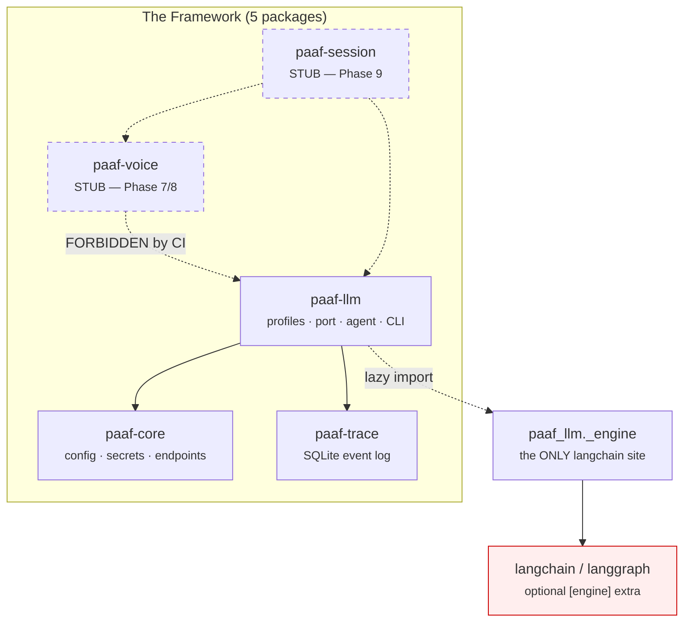

Dashed = not built yet. The red-crossed edge is a **CI failure**, not a convention.

---

## 2. The two rules the whole design rests on

### Rule 1 — the agent framework is confined to one directory

`.importlinter` declares three contracts that turn architecture into build failures:

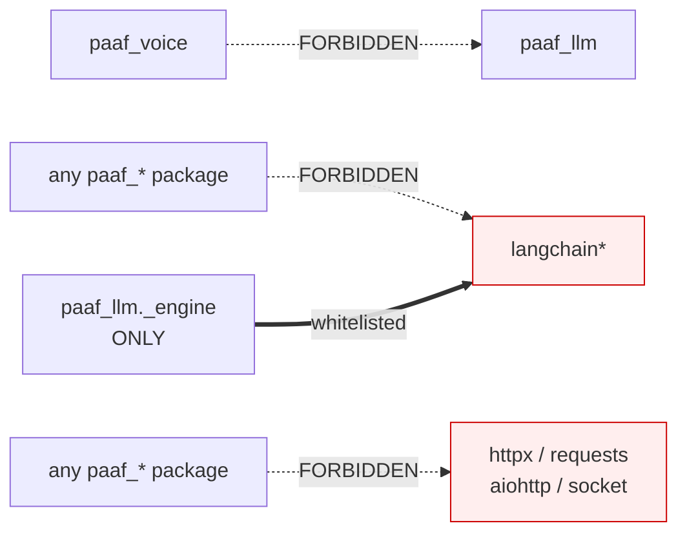

| Contract | Enforces |
|---|---|
| `voice-and-llm-are-independent` | Voice and LLM stay swappable in both directions |
| `langchain-confined-to-adapter` | Swap the agent framework by rewriting **one file** |
| `no-network-client-in-framework` | Nothing in the framework can phone home (PRIV-02) |

Each contract has a **negative control** in `tests/negcontrol/` — a deliberately violating fake package that proves the contract actually goes red. A check that can't fail isn't a check.

### Rule 2 — the whole suite runs with the framework uninstalled

```bash
bash scripts/check_framework_uninstalled.sh
# builds wheels → clean off-repo venv → pytest --pyargs paaf_llm → 102 passed
# then asserts `import langchain` raises ModuleNotFoundError
```

This is why the test suite **ships inside the wheel**. If the port were secretly a mirror of LangChain's shape, this job would be impossible.

---

## 3. `paaf-core` — the substrate

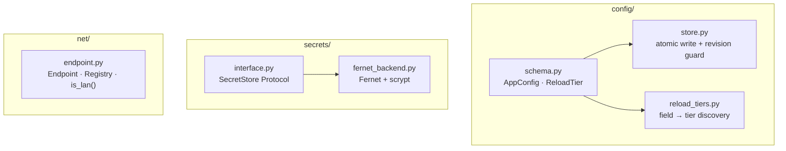

### Reload tiers (CORE-06)

Every config field declares how it can be applied. The desktop app (Phase 11) reads this map so it can say *"this needs a restart"* instead of silently doing nothing.

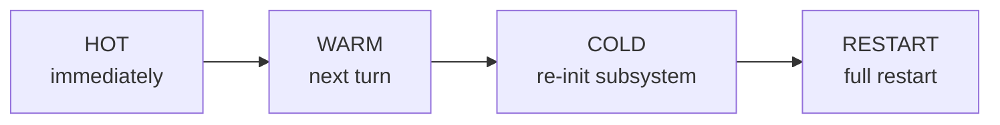

```python
from paaf_core.config import reload_tiers, AppConfig

reload_tiers(AppConfig)
# {'revision': RESTART, 'persona': RESTART,          # no tier declared → conservative default
#  'voice.tts_volume': HOT, 'voice.stt_model': COLD,
#  'model.temperature': WARM, 'model.provider': RESTART}
```

### Atomic, conflict-guarded writes (CORE-02/03)

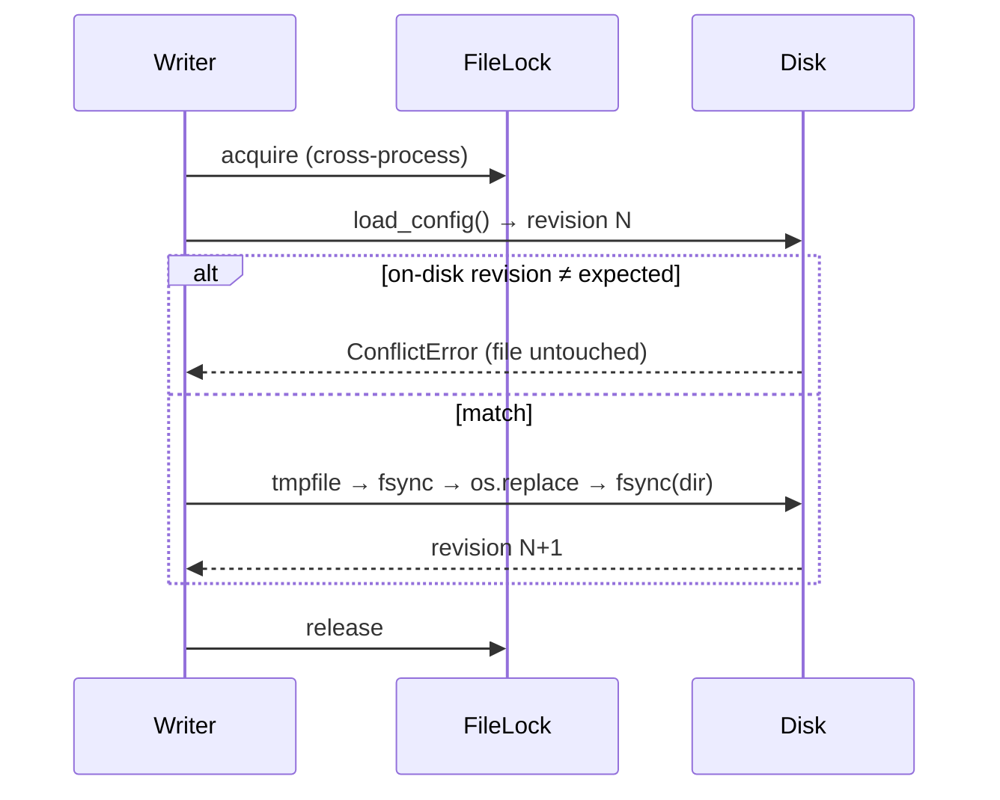

The lock is what makes the revision guard non-vacuous — without it two processes both read N and both write N+1.

### Endpoint declaration (CORE-05) — offline mode is *architectural*

No scattered `if offline:` checks. Components declare endpoints through one interface; `is_lan()` classifies **without DNS** (no socket, so it's safe under the suite-wide `--disable-socket`).

```python
from paaf_core.net import Endpoint, EndpointRegistry

Endpoint("192.168.1.10", 11434, "http").is_lan()   # True  (RFC1918)
Endpoint("api.anthropic.com", 443, "https").is_lan()  # False

reg = EndpointRegistry()
reg.register(some_component)          # any object with declare_endpoints()
reg.non_lan_endpoints()               # ← exactly what Phase 9's APP-08 refuses
```

`ModelProfile.endpoint()` plugs into this, so a model endpoint is visible to offline enforcement through the *same* interface as everything else.

### Secrets (CORE-04)

`SecretStore` is a `Protocol`; `EncryptedFileSecretStore` (Fernet + scrypt, passphrase-at-unlock) is the v1 backend. `list_keys()` returns **names only**. Config YAML holds `api_key_ref` — the *name* of a key — never a value.

---

## 4. `paaf-trace` — the local event log

Raw SQL, no ORM. Two tables:

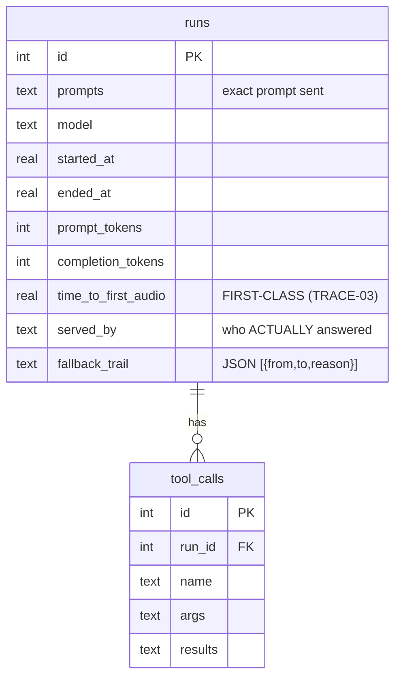

`tool_calls` is written by Phase 5. `time_to_first_audio` is written by Phase 9 — but it's **already defended by a CI regression gate** using `paaf_trace._testing.fake_tts.FakeTTS` driven by an injected clock, before any real audio engine exists.

### The single-writer queue

```mermaid
graph LR
    A["Audio hot path<br/>or turn loop"] -->|emit() SYNC<br/>put_nowait| Q[("bounded queue<br/>maxsize=1000")]
    Q --> W["one writer task<br/>owns the connection"]
    W --> DB[("SQLite<br/>WAL · synchronous=NORMAL")]
    Q -.->|full| X["dropped++<br/>never blocks"]
    style X fill:#ffe
```

`emit()` **never awaits**. Audio must never stall behind disk I/O. Overflow increments a counter rather than blocking — dropping a trace row is acceptable, stuttering the user's speech is not.

---

## 5. `paaf-llm` — the mind

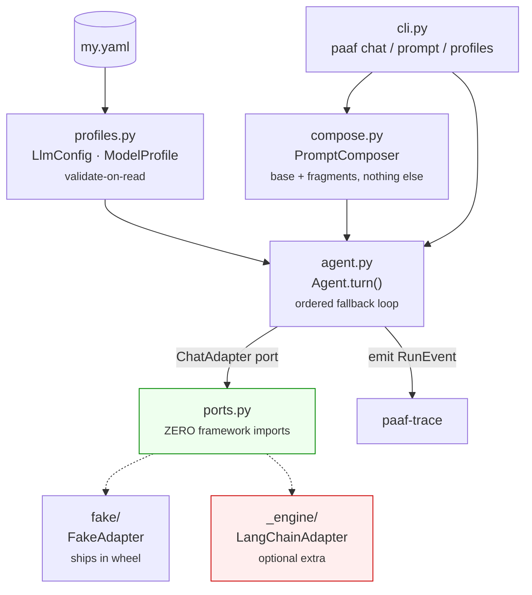

### 5.1 The config the user owns

```yaml
# my.yaml — no code, ever
base_prompt: |
  You are Iris. You are terse. You never apologize.

active_profile: local-big
fallback_chain: [local-small, cloud]

profiles:
  local-big:
    provider: ollama
    model: qwen3:14b
    endpoint_host: 192.168.1.10        # ← LAN box #1
    endpoint_port: 11434
    temperature: 0.7
    first_token_budget_s: 10.0
    capabilities: "Long reasoning, code, Russian and Hebrew."   # FREE TEXT
    peers: [local-small]               # inert until Phase 4
    constraints: ["never send audio off-device"]

  local-small:
    provider: ollama
    model: qwen3:4b
    endpoint_host: 192.168.1.11        # ← LAN box #2, a DISTINCT profile
    endpoint_port: 11434
    first_token_budget_s: 4.0
    capabilities: "Fast short answers, timers, smart-home commands."

  cloud:
    provider: anthropic
    model: claude-sonnet-4-5
    api_key_ref: anthropic_key         # the NAME of a SecretStore key
    capabilities: "Anything the local models cannot do."
```

Two deliberate design calls:

- **`capabilities` is free text, never structured fields.** Structured capability fields would be a routing DSL by the back door. Phase 4's mesh reads natural language — and so can you.
- **`fallback_chain` ≠ `peers`.** Fallback is *resilience* (the active model is unreachable). Peers are *handoff on the merits* (Phase 4). Collapsing them would quietly make every fallback target a handoff target.

`extra: "forbid"` everywhere: a hand-edited config is untrusted input, so no smuggled field can ride along. `_check_refs` rejects a dangling `active_profile`, a dangling fallback target, a dangling peer, and a self-peer — **at load**, so Phase 4 never traverses a broken graph at runtime.

### 5.2 The port — `ChatAdapter`

This is the entire surface between PAAF and whatever framework serves a turn.

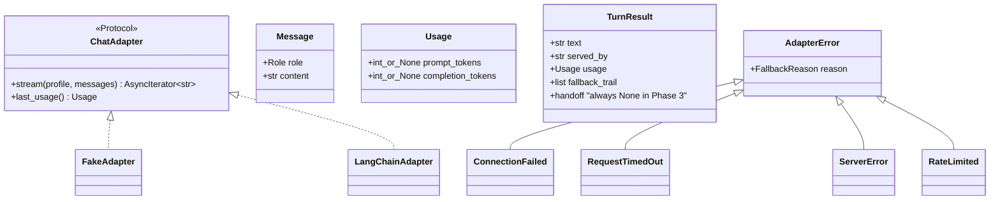

Two methods. PAAF value types only. **`ports.py` imports nothing but the stdlib** — asserted against the file's own source text *and* against the import graph.

`Usage` counts are `int | None` because they honestly may be unknown — Ollama publishes usage on roughly one chunk in 334 (SPIKE-05). `None` means *"the provider did not say"*, which is different from zero. Inventing a number would make the trace lie.

`last_usage()` is read **after** aggregation, never per chunk.

### 5.3 Failure classification — four errors, five reasons

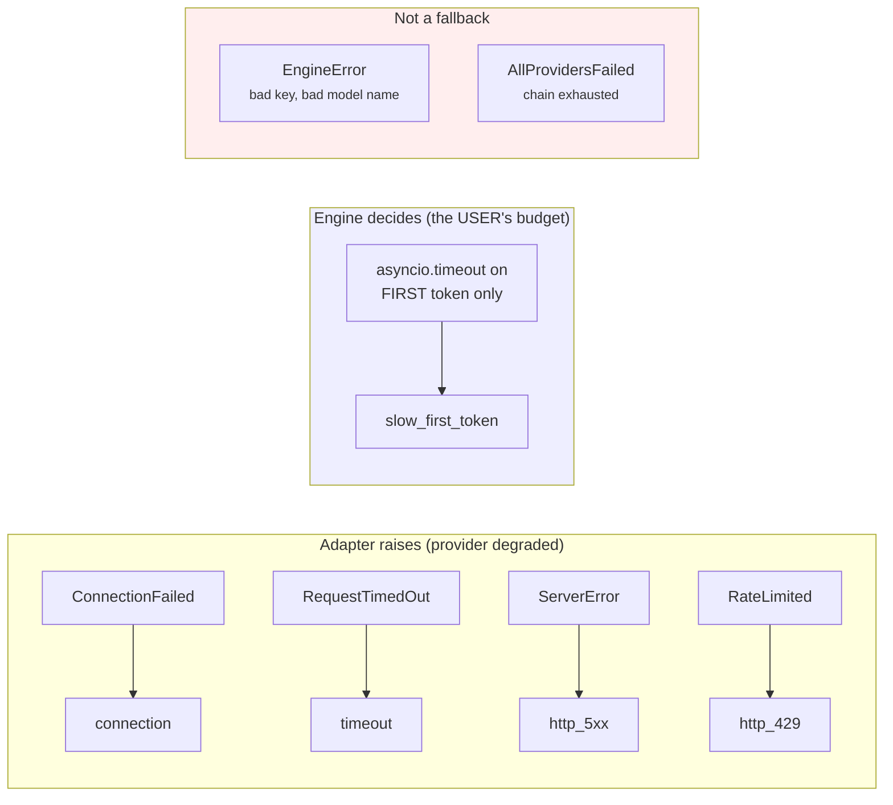

**No adapter can raise `slow_first_token`.** "Too slow" is the user's judgement (`first_token_budget_s`), so only the engine may say it. A fake that raised it itself would let a broken engine — one with no deadline at all — pass the very test written to catch it.

**`EngineError` is deliberately not an `AdapterError`.** A missing API key is a config error, not a degraded provider. Translating it into a fallback reason would print `↳ fell back to cloud (connection)` at someone whose real problem is a typo.

### 5.4 The turn loop

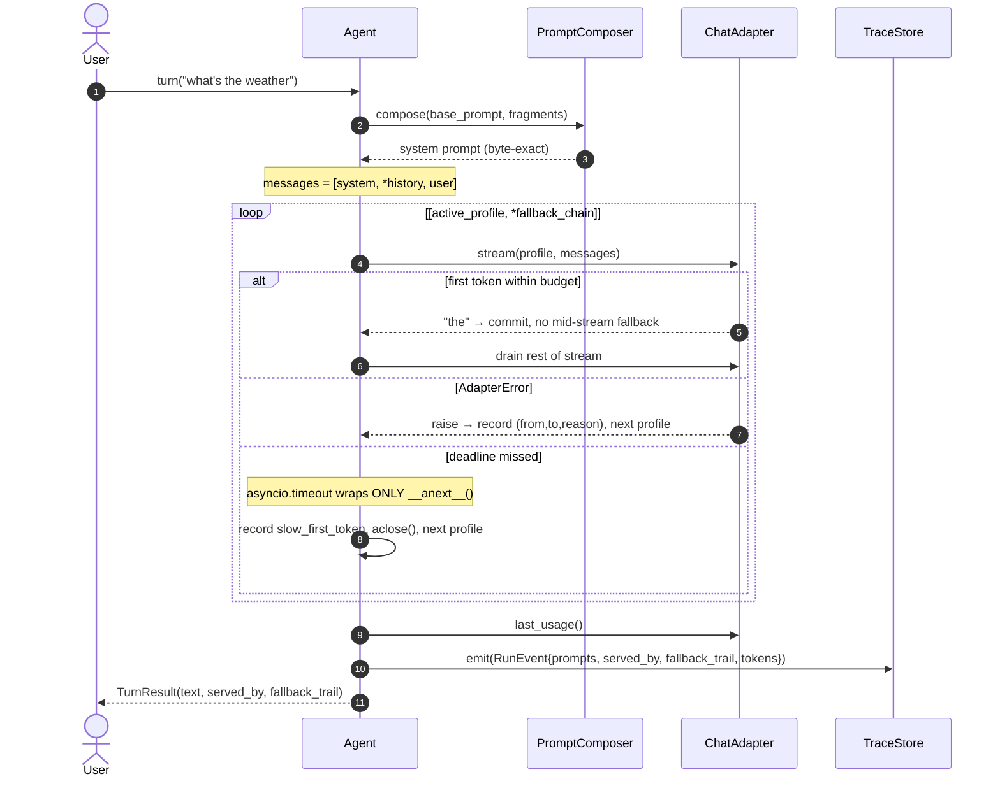

Four things that are load-bearing:

1. **The deadline covers only time-to-first-token.** A deadline around the whole stream would abort long healthy replies — while passing every test a fake can express.
2. **No mid-stream fallback.** Once a token flows, the profile has committed.
3. **Two clocks.** `Agent.warmup()` pays cold-model load cost once at startup (`preload`), so the per-turn deadline measures a *warm* model. Otherwise a 14B Ollama model false-triggers on every first turn.
4. **History is ephemeral and in-memory.** A turn nobody answered is never appended.

Why hand-roll this instead of using LangChain's `ModelFallbackMiddleware`? Three reasons: the framework's fallbacks fire only when *creating* the stream raises (so they can't see a 40-second first token), they can't run at all with the framework uninstalled (SC#1), and they can't record *why* each hop happened.

### 5.5 Prompt composition — "nothing hidden" as a function, not a promise

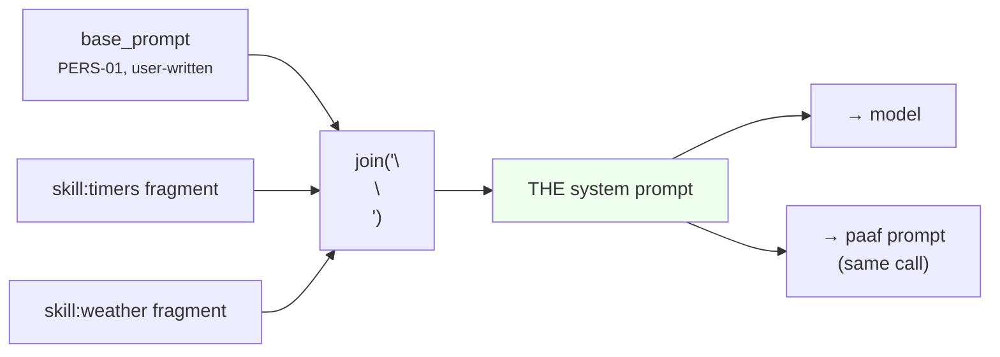

There is **exactly one** code path. `paaf prompt`, `paaf chat --show-prompt`, and the live turn all call the same `PromptComposer`. A second derivation is the only way an inspector can quietly understate what was sent — so there isn't one.

PAAF adds **no** preamble, no trailing instruction, no safety wrapper, no hidden prompt-injection defense. `test_compose.py` asserts this by splitting the output back apart and demanding it equal `[base, *fragments]`.

```bash
paaf prompt --config my.yaml > sent.txt   # exact bytes — no trailing newline
diff sent.txt captured.txt                 # meaningful
```

```bash
paaf prompt --config my.yaml --provenance
--- base ---
You are Iris. You are terse. You never apologize.
--- skill:timers ---
You can set and cancel timers.
```

Provenance is **opt-in and never authoritative** — labels laid *around* the content, never a filter over it. Rejoining the segment texts reproduces `compose()` byte-for-byte.

### 5.6 The real adapter — `paaf_llm._engine`

The single file that knows an agent framework exists.

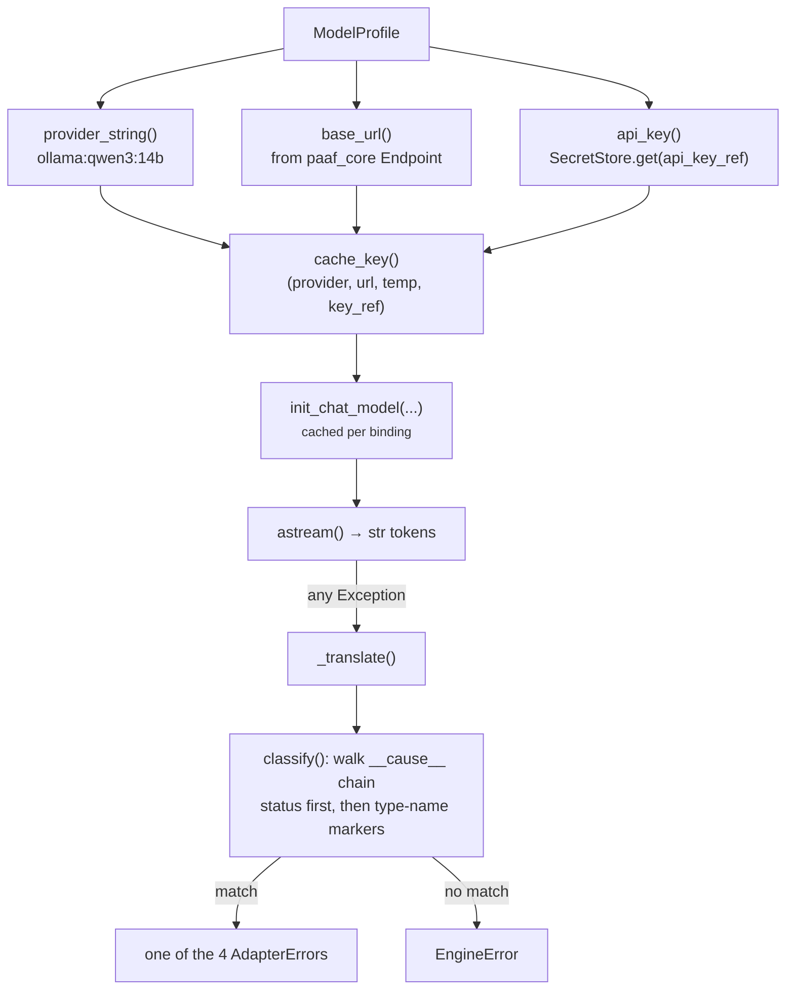

Notable choices:

- **Lazy import.** `langchain` is pulled in inside `_framework()`, on first bind. A `find_spec` probe at module import makes the "install the extra" message possible.
- **No provider SDKs imported.** Classification duck-types on HTTP status and exception *type names*, so this module doesn't depend on `ollama`, `openai`, or `anthropic` packages.
- **Order matters in `classify`.** `openai.APITimeoutError` subclasses `APIConnectionError`, so testing connection first would silently reclassify every timeout.
- **`str(chunk.text)` is not decoration.** LangChain's `.text` is a `TextAccessor` (a `str` subclass) — letting it cross the port would leak a framework type.
- **Cache key includes model + url + temperature + key ref.** Two Anthropic profiles naming the same model both declare no endpoint; keying on less would make the second silently inherit the first's temperature and credential.
- **Secrets are scrubbed** from every raised message — the realistic leak is a provider echoing the credential it rejected.

### 5.7 The CLI — deliberately the thinnest file

Every correctness claim it makes is one the library already proves against the fake.

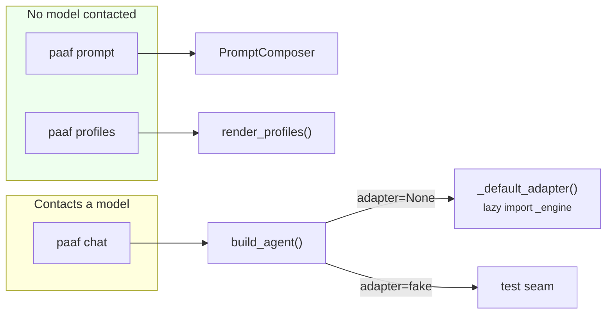

`Console(markup=False, highlight=False)` is load-bearing: a profile whose `capabilities` string contains `[/]` must not be able to restyle or hide surrounding output. The byte-exact prompt path skips `rich` entirely.

---

## 6. End-to-end: one `paaf chat` turn

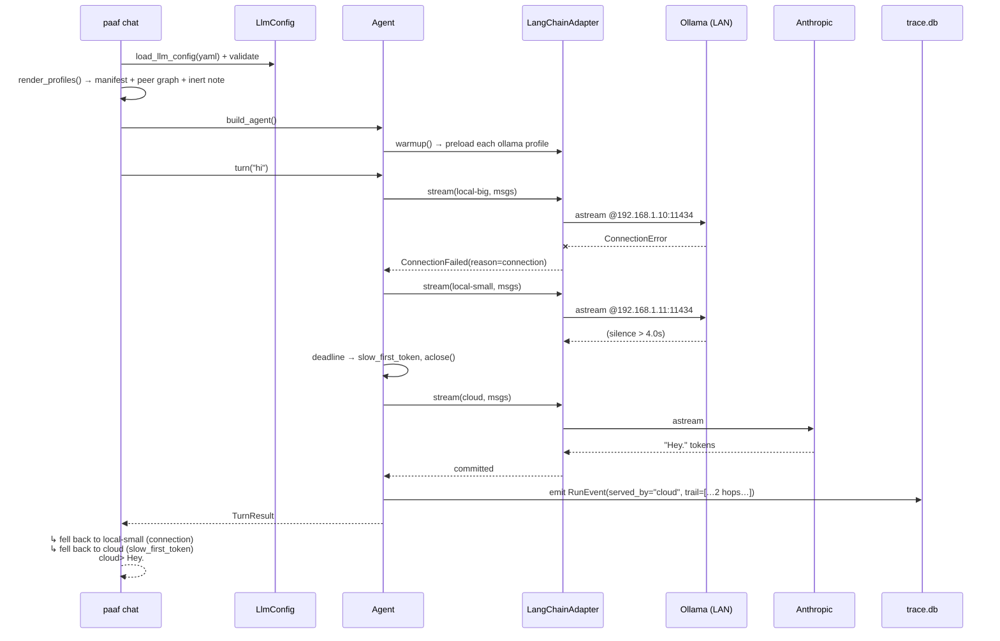

---

## 7. Using the framework

The public API is `paaf_llm`'s `__all__` — 14 names, **all PAAF types**. `tests/test_no_leak.py` walks every public signature and fails if an annotation resolves to a framework module.

### 7.1 Drive an agent from Python (no CLI, no network)

```python
import asyncio
from paaf_llm import FakeAdapter, LlmConfig, ServerError

config = LlmConfig.model_validate({
    "base_prompt": "You are terse.",
    "active_profile": "local",
    "fallback_chain": ["cloud"],
    "profiles": {
        "local": {"provider": "ollama", "model": "local", "first_token_budget_s": 2.0},
        "cloud": {"provider": "anthropic", "model": "cloud"},
    },
})

adapter = FakeAdapter()
adapter.program("local", fail=ServerError)          # provider degrades
adapter.program("cloud", tokens=["He", "llo"])      # backup answers

from paaf_llm.agent import Agent
agent = Agent.build(config, adapter)

result = asyncio.run(agent.turn("hi"))
result.text            # "Hello"
result.served_by       # "cloud"
result.fallback_trail  # [("local", "cloud", "http_5xx")]
result.usage           # Usage(prompt_tokens=7, completion_tokens=3)
```

`FakeAdapter` **ships in the wheel** — it's a supported testing tool for anyone building on PAAF, not an internal fixture. Un-programmed profiles raise `LookupError` (pointedly *not* an `AdapterError`), so a forgotten `program()` call can't be swallowed as one more plausible hop.

### 7.2 Write your own adapter (swap the framework entirely)

Implement two methods. That's the whole contract.

```python
from collections.abc import AsyncIterator, Sequence
from paaf_llm import Message, ModelProfile, Usage, ConnectionFailed

class MyAdapter:
    async def stream(
        self, profile: ModelProfile, messages: Sequence[Message]
    ) -> AsyncIterator[str]:
        try:
            async for chunk in my_sdk.stream(profile.model, messages):
                yield chunk.text
        except MySDKUnreachable as exc:
            raise ConnectionFailed(str(exc)) from exc   # translate — never leak

    def last_usage(self) -> Usage:
        return Usage(prompt_tokens=..., completion_tokens=...)

    # optional: implement preload(profile) to opt into Agent.warmup()
```

Nothing in `paaf_llm` outside `_engine/` knows LangChain exists — so this is genuinely all it takes.

### 7.3 Drain traces to your own store

```python
class MySink:                      # the TraceSink protocol is one method
    def emit(self, event: object) -> None:
        print(event)               # must NOT block or await

agent = Agent.build(config, adapter, trace=MySink())
```

Or use the real store:

```python
from paaf_trace.store import TraceStore

store = TraceStore("trace.db")
await store.start()
agent = Agent.build(config, adapter, trace=store)
...
await store.stop()                 # flushes everything emitted
```

### 7.4 Inject skill fragments (ahead of Phase 6)

```python
agent = Agent.build(config, adapter, skill_fragments=[
    ("timers", "You can set and cancel timers."),
])
agent.system_prompt()
# "You are terse.\n\nYou can set and cancel timers."
```

---

## 8. Stubs, seams, and deliberate no-ops

Everything below is **in the code today** and does nothing on purpose. Each is shaped so the phase that fills it adds no method and changes no signature.

| Seam | Where | Today | Filled by |
|---|---|---|---|
| `TurnResult.handoff` | `ports.py` | always `None`, hardcoded | **Phase 4** (MESH-02) |
| `ModelProfile.peers` | `profiles.py` | validated, displayed, never traversed | **Phase 4** |
| `ModelProfile.constraints` | `profiles.py` | validated free text, unenforced | **Phase 4** (MESH-06) |
| `load_skill_fragments()` | `cli.py` | returns `[]` — a *named* seam, not an inline `[]` | **Phase 6** (PERS-02) |
| `Agent._secret_store` | `agent.py` | held, unused (key resolution is the adapter's job) | Phase 4/5 |
| `tool_calls` table | `schema.sql` | table exists, nothing writes it | **Phase 5** |
| `time_to_first_audio` | `schema.sql` | column + CI gate exist, driven by `FakeTTS` | **Phase 9** |
| `EndpointRegistry` | `paaf_core.net` | collects + classifies; nobody refuses yet | **Phase 9** (APP-08) |
| `paaf_voice` | package | `__version__` only | **Phases 7–8** |
| `paaf_session` | package | `__version__` only | **Phase 9** |
| Runtime context in prompt | `compose.py` | not composed (PERS-03 out of scope) | **Phase 10** |

Why seams instead of nothing: `TurnResult.handoff` existing now means Phase 4 sets a field rather than reshaping the port. `load_skill_fragments()` existing as a function means the agent and the inspector read fragments from **one place**, so Phase 6 can't make them drift.

The inertness has a real negative control, not just a comment: `test_manifest_performs_no_handoff` leaves the declared peer **unprogrammed** in the fake, so any contact with it raises `LookupError`.

---

## 9. Known gaps (from `03-VERIFICATION.md`)

Phase 3 verified **3 of 5** success criteria. Carried forward, honestly:

| Gap | Impact | Where |
|---|---|---|
| `cli._default_adapter` never passes a secret store | Any profile with `api_key_ref` dies at bind with `EngineError`. Cloud profiles reachable only via the provider SDK's own env var — routing around CORE-04. | `cli.py:138` |
| `Endpoint` has no path field | An OpenAI-compatible server at `/v1` (vLLM, llama.cpp, LM Studio) is **inexpressible**. The adapter refuses to guess a suffix rather than silently rewrite a declared endpoint. | `_engine/__init__.py` `base_url()` |
| No way to say "this endpoint needs no auth" | An unauthenticated LAN OpenAI-compatible server can't bind — `ChatOpenAI` demands credentials. | `profiles.py` |
| `_chat_loop` catches only `AllProvidersFailed` | `EngineError` (the most likely first-run failure — bad key, wrong model name) escapes as a raw traceback. | `cli.py:244` |
| No test binds an `openai_compatible` profile | The one provider with no binding-level coverage — which is why the two gaps above weren't caught. | `test_engine_adapter.py` |

**Verified only by hand, never by CI** (the suite is socket-disabled by design, so no test contacts a real provider):

- Pulling the WAN mid-conversation and continuing on a local profile.
- Cold-starting a 14B Ollama model without a spurious `slow_first_token`.
- Two Ollama profiles answering from two *physically different* LAN boxes.

Real-provider exception translation *is* validated — against 13 real SDK exception instances, offline.

---

## 10. What Phase 4 changes

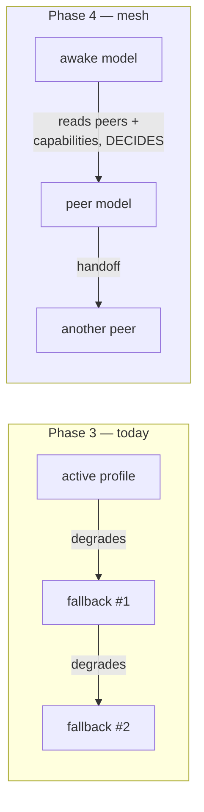

Fallback is *"my provider broke."* Handoff is *"this isn't my job."* Phase 4 makes `peers` live, sets `TurnResult.handoff`, and puts the full handoff chain in the trace — with **no hardcoded routing rules**: the awake model decides, reading the same free-text capability manifests you wrote.

The composer stays the enforcement point: Phase 4's generated handoff explainer must appear in the composed prompt **verbatim**, or PERS-05 is broken.

---

## Appendix — commands

```bash
uv sync                                        # workspace + dev tools
uv run pytest                                  # whole suite, socket-disabled
uv run lint-imports                            # the three architecture contracts
uv run ruff check . && uv run mypy .
bash scripts/check_framework_uninstalled.sh    # SC#1 gate
bash scripts/check_wheel_independence.sh       # FOUND-02 gate
uv pip install -e 'packages/paaf-llm[engine]'  # add the real adapter
```
